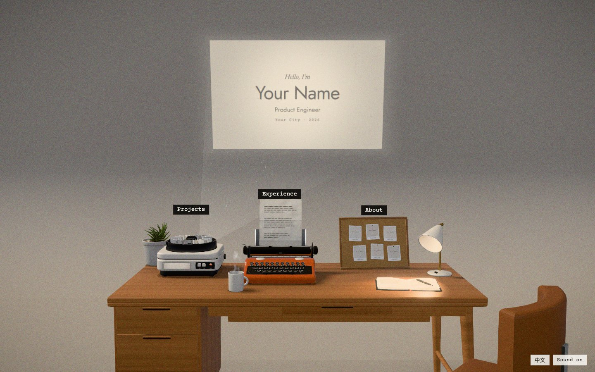
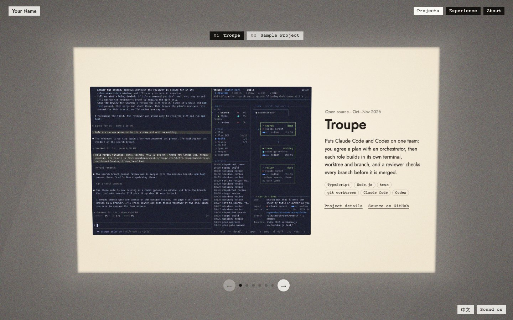
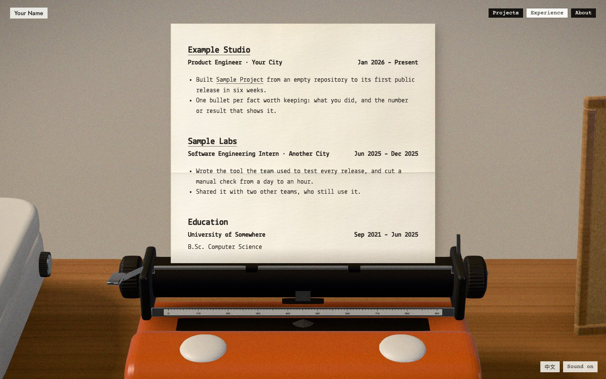
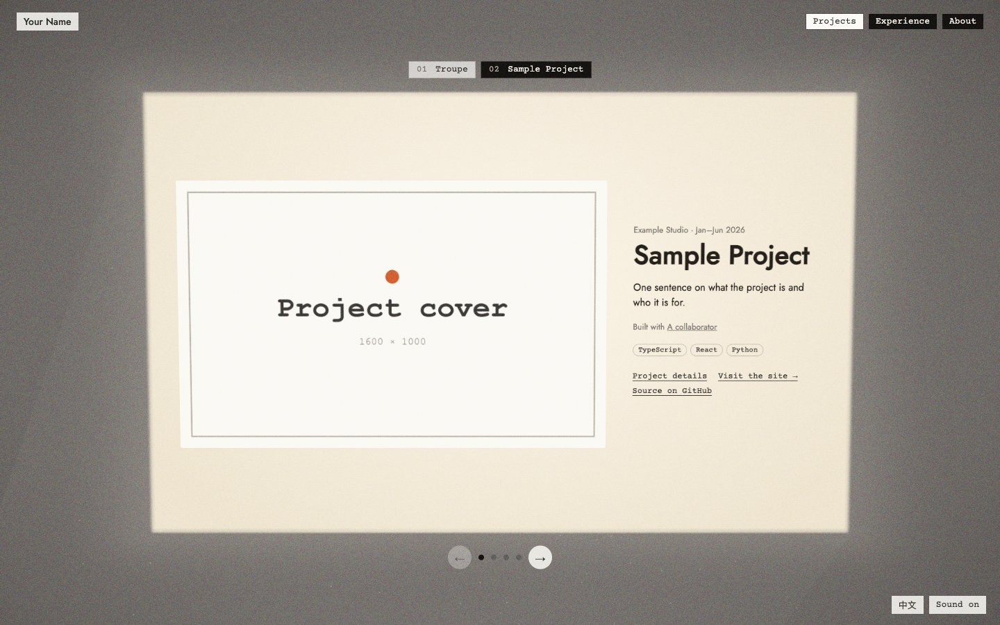
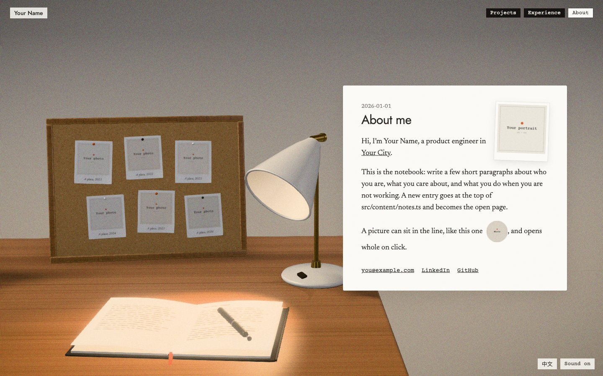

<p align="center">
  
</p>

<p align="center">
  A personal site template built as one 3D studio set.<br>
  Each object on the desk is a page; your content is a few TypeScript files.
</p>

<p align="center">
  <a href="README.md"></a>
  <a href="README.zh-CN.md"></a>
</p>

<p align="center">
  <a href="https://tianqiz.me"></a>
  <a href="#quick-start"></a>
  <a href="#make-it-yours"></a>
</p>

<p align="center">
  <a href="LICENSE"></a>
  
  
  
</p>

## The pages

The camera walks from one object to the next; what you read is real text laid
over the shot, so it can be selected, searched and printed. Every page reads
in English and Chinese.

| Page | Object | What it does |
|---|---|---|
| Landing `/` | the whole set | The projector throws a title slide (your name, a caption, a place) on the wall. Each object wears a tag that opens its page. |
| Projects `/projects` | slide projector | One tray of slides per project: a cover, a film if you have one, a picture and a note per slide, then the results. "Project details" opens the long version. |
| Experience `/experience` | typewriter | Your CV feeds out on a roll of paper, and the newest company name types in. |
| About `/about` | pinboard and notebook | Photos on the board, your writing in the notebook, a portrait and contact links. |

<p align="center">
  
  
</p>
<p align="center">
  
  
</p>

The template ships with sample content: an invented person, two sample jobs,
one note, placeholder cards where photos go, and two project trays.
**Troupe** is a real example (an open-source project by the template's
author; its films are served from his site's media host), and **Sample
Project** is a placeholder that uses every field a tray can have.

## Quick start

You need **Node.js 22** (see `.nvmrc`).

```sh
git clone https://github.com/hitianqi/desk-portfolio.git
cd desk-portfolio
npm install
npm run dev
```

Open the address Vite prints. The opening is a black terminal: click "Turn on
the lights", then anywhere, to see the set.

`npm run check` type-checks and builds to `dist/`; `npm run preview` serves
the build. The chunk-size warning is expected (three.js).

## Make it yours

Everything you write lives in `src/content/`; the scene reads it and grows
with it. Text a reader sees in their language is a `{ en, zh }` pair; names,
dates and numbers can stay one string.

1. **`src/content/site.ts`**: your name, caption, place, email and links.
   They make the title slide and close the About page. Also change the
   `<title>` and descriptions in `index.html`.
2. **A job**: add an entry at the top of `experience` in
   `src/content/experience.ts` (company, its site, role, place, dates, two or
   three bullets). Schools go in `education` below it. A bullet can link to a
   project's tray with `[text](/projects/<id>)`.
3. **A project**: add an entry to `projects` in `src/content/projects.ts` and
   put its pictures in `public/projects/<id>/`. Copy the `sample-project`
   entry: it shows every field (`cover`, `slides`, `film`, `metrics`,
   `results`, `disclaimer`, `details`, `site`, `links`). Pictures are 16:10 or
   16:9, about 1600 px wide. Delete the entries you do not want, Troupe
   included.
4. **A note**: add an entry at the top of `notes` in `src/content/notes.ts`;
   the newest is the open page. Paragraphs are separated by a blank line,
   `` puts a small round picture in the line, and
   `[text](/about/x.jpg)` opens a picture over the page. The portrait at the
   head of the page is `public/about/portrait.jpg` (480×480).
5. **A photo**: the board holds six. Put a square print (512×512) in
   `public/board/` and the whole photo (about 1600 px on the long side) in
   `public/board/full/`, then set `src`, `full` and `caption` in
   `src/content/board.ts`.
6. **The favicon** is `public/favicon.svg`, with `favicon.ico` and
   `apple-touch-icon.png` beside it.

### Films

A project's film plays as the slide after its cover: a 60–90 second screen
recording with a poster image. Videos are too heavy for the repository, so
host them anywhere that serves video files over HTTPS (Cloudflare R2, S3, a
CDN, your own server) and set `film.src` to the URL; the poster goes in
`public/projects/<id>/`. A film made in both languages takes `src` and
`poster` as `{ en, zh }` pairs. Without a `film` field, the tray simply has no
film slide.

## Deploy

The site is a single-page app with real paths (`/projects`, `/experience`,
`/about`), so the host must fall back to `index.html` for unknown paths.

- **Cloudflare Workers** (as configured): `wrangler.jsonc` serves `dist/` as
  static assets with that fallback. Change `"name"`, then `npm run build` and
  `npx wrangler deploy`, or connect the repository in the Cloudflare
  dashboard so every push builds. `npx wrangler dev` serves the build the way
  Cloudflare will.
- **Any static host** works the same way (Netlify, Vercel, GitHub Pages with
  a 404 fallback, nginx): build with `npm run build`, publish `dist/`, and
  route unknown paths to `index.html`.

## Where things are

- `src/content/`: everything you write (see [Make it yours](#make-it-yours)).
- `src/route.ts`: the four pages as URL paths. Esc returns to the whole set.
- `src/App.tsx`: the canvas, the nav, and which reading layer shows.
- `src/scene/shots.ts`: where each object stands and the camera shot per page.
- `src/scene/CameraRig.tsx`: eases the camera between shots; widens the lens
  and steps back on portrait screens.
- `src/scene/Studio.tsx`: the cove, lights, desk, projector beam and the
  slide on the wall.
- `src/scene/Projector.tsx`, `Typewriter.tsx`, `Notebook.tsx`,
  `Corkboard.tsx`: the four objects, modelled in code.
- `src/scene/look.ts`: the palette and the canvas-drawn textures.
- `src/Intro.tsx`: the black opening, a terminal printing the call sheet
  while the set loads.
- `src/sound.ts`: the switch, projector, key, line-feed and bell sounds, and
  the room tone (`public/audio/room.mp3`); the bottom-right toggle turns them
  off, remembered per browser.
- `src/scene/Tags.tsx`: the hand-written tags on the landing.
- `src/pages/`: the reading layers (project slides and details, the paper
  roll, the notebook).
- `docs/preview/`: screenshots, 1440×900 and 390×844.
- [AGENTS.md](AGENTS.md): the brief for coding agents (Claude Code, Codex)
  working on the scene: its design rules, how to check a change, and the
  known traps.

Printing the Experience page (the browser's own Print) gives the CV alone,
from the print stylesheet in `src/styles.css`.

## Credits and licence

Made by [Tianqi Zhao](https://tianqiz.me), whose own site runs on it.

The idea of a desk as a site, and a few finishing touches (the film grain,
the coffee steam, the room tone, the "Click anywhere to begin" opening), come
from [Henry Heffernan's portfolio](https://github.com/henryjeff/portfolio-website)
(MIT). The plant and the studio lighting are from
[Poly Haven](https://polyhaven.com) (CC0). Details are in
[NOTICE.md](NOTICE.md); keep it with your copy.

MIT, see [LICENSE](LICENSE).
