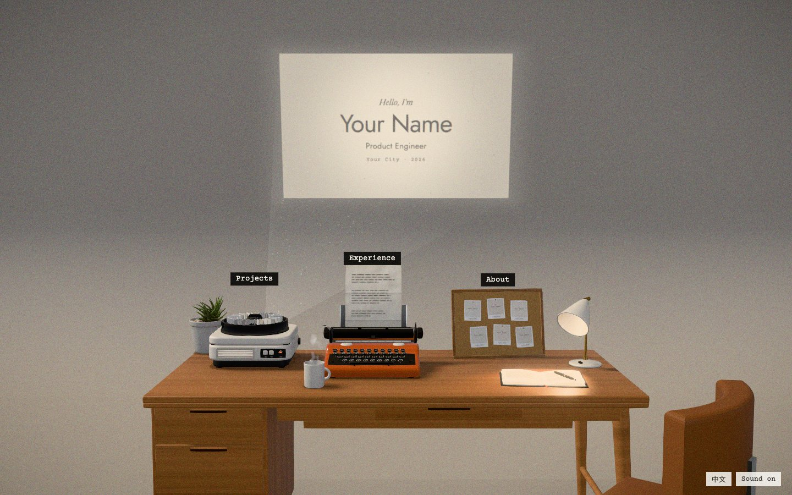
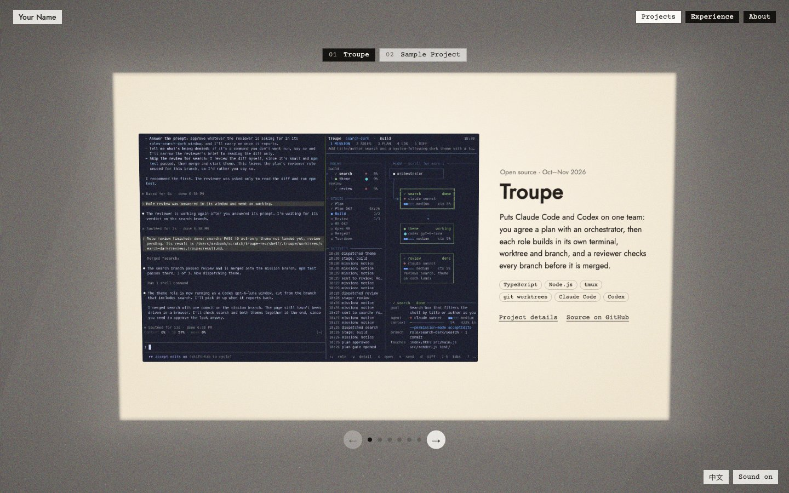
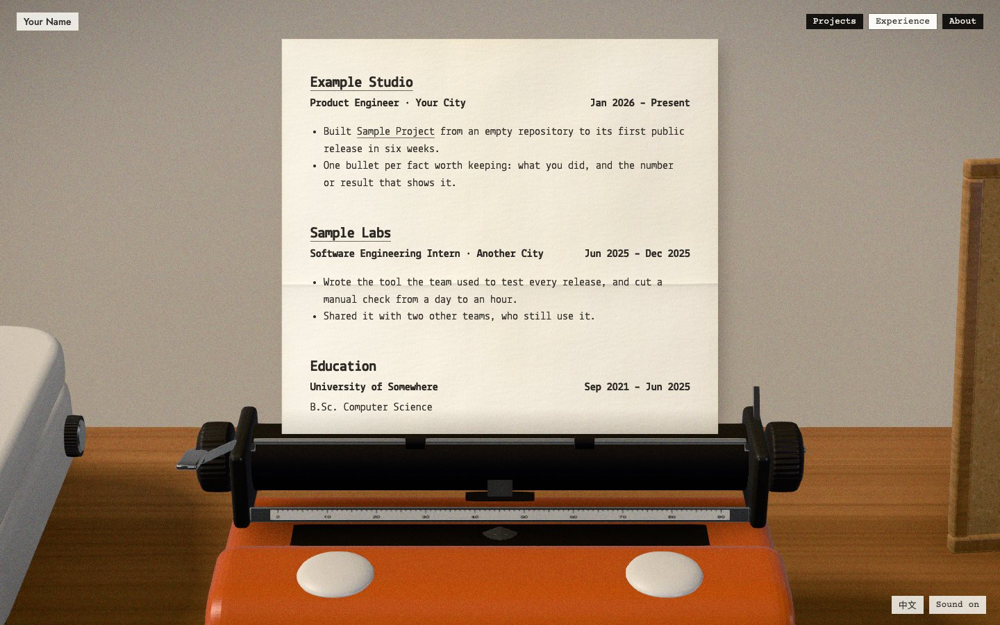
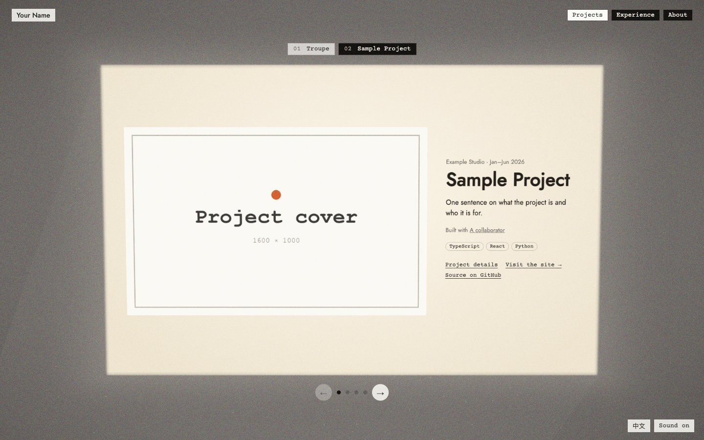
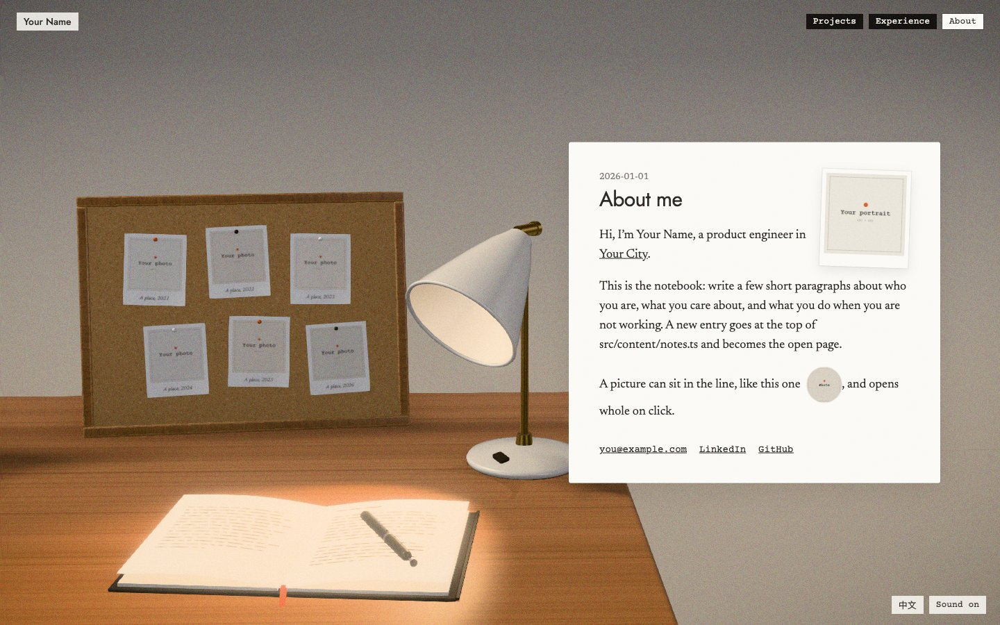

<p align="center">
  
</p>

<p align="center">
  一个做成 3D 摄影棚的个人网站模板。<br>
  桌上的每个物件是一个页面；你的内容只是几个 TypeScript 文件。
</p>

<p align="center">
  <a href="README.md"></a>
  <a href="README.zh-CN.md"></a>
</p>

<p align="center">
  <a href="https://tianqiz.me"></a>
  <a href="#快速开始"></a>
  <a href="#改成你自己的"></a>
</p>

<p align="center">
  <a href="LICENSE"></a>
  
  
  
</p>

## 页面

镜头从一个物件走到下一个；你读到的是叠在画面上的真实文字，可以选中、搜索和打印。每个页面都有中英两种语言。

| 页面 | 物件 | 做什么 |
|---|---|---|
| 首页 `/` | 整个布景 | 投影仪在墙上投出标题幻灯片（你的名字、一句介绍、所在地）。每个物件挂着一个标签，点开就是它的页面。 |
| 项目 `/projects` | 幻灯片投影仪 | 每个项目一盒幻灯片：封面，有的话再放一段演示片，然后每张一图一段说明，最后是结果。“项目详情”打开完整版。 |
| 经历 `/experience` | 打字机 | 简历印在一卷纸上送出来，最新的公司名逐字打上去。 |
| 关于 `/about` | 软木板和笔记本 | 板上钉着照片，笔记本里是你写的文字、一张头像和联系方式。 |

<p align="center">
  
  
</p>
<p align="center">
  
  
</p>

模板自带示例内容：一个虚构的人、两段示例工作经历、一篇笔记、照片位置上的占位卡片，以及两盒项目幻灯片。**Troupe** 是一个真实的例子（模板作者的开源项目，演示片从他网站的媒体服务器加载），**Sample Project** 是一个用上了全部字段的占位项目。

## 快速开始

需要 **Node.js 22**（见 `.nvmrc`）。

```sh
git clone https://github.com/hitianqi/desk-portfolio.git
cd desk-portfolio
npm install
npm run dev
```

打开 Vite 打印的地址。开场是一个黑色终端：点击 “Turn on the lights”，再点任意处，就能看到布景。

`npm run check` 做类型检查并构建到 `dist/`；`npm run preview` 预览构建结果。关于 chunk 体积的警告是预期内的（three.js）。

## 改成你自己的

你写的所有内容都在 `src/content/` 里；场景读取它们，内容多了布景也跟着长。读者会按语言看到的文字写成 `{ en, zh }` 一对；名字、日期和数字可以只写一个字符串。

1. **`src/content/site.ts`**：你的名字、一句介绍、所在地、邮箱和链接。它们组成首页的标题幻灯片，也出现在关于页末尾。别忘了改 `index.html` 里的 `<title>` 和描述。
2. **加一段工作**：在 `src/content/experience.ts` 的 `experience` 最前面加一项（公司、公司网址、职位、地点、起止时间、两三条要点）。学校写在下面的 `education` 里。要点里可以用 `[文字](/projects/<id>)` 链接到某个项目。
3. **加一个项目**：在 `src/content/projects.ts` 的 `projects` 里加一项，图片放在 `public/projects/<id>/`。照着 `sample-project` 那一项抄：它用上了所有字段（`cover`、`slides`、`film`、`metrics`、`results`、`disclaimer`、`details`、`site`、`links`）。图片用 16:10 或 16:9，宽约 1600 像素。不要的项目直接删掉，Troupe 也一样。
4. **加一篇笔记**：在 `src/content/notes.ts` 的 `notes` 最前面加一项，最新的一篇就是翻开的那一页。段落之间空一行；`` 在行内放一张小圆图，`[文字](/about/x.jpg)` 点击后在页面上打开一张图。页首的头像是 `public/about/portrait.jpg`（480×480）。
5. **加一张照片**：软木板上有六个位置。方形小图（512×512）放进 `public/board/`，完整照片（长边约 1600 像素）放进 `public/board/full/`，再在 `src/content/board.ts` 里填好 `src`、`full` 和 `caption`。
6. **网站图标**是 `public/favicon.svg`，旁边还有 `favicon.ico` 和 `apple-touch-icon.png`。

### 演示片

项目的演示片是封面后面的那张幻灯片：一段 60–90 秒的录屏，加一张封面图。视频太大，不放进仓库：放到任何能通过 HTTPS 提供视频文件的地方（Cloudflare R2、S3、CDN、你自己的服务器），把 `film.src` 设成它的地址；封面图放在 `public/projects/<id>/`。中英文各做了一版的话，`src` 和 `poster` 写成 `{ en, zh }` 一对。没有 `film` 字段，这盒幻灯片就没有演示片那一张。

## 部署

网站是一个使用真实路径（`/projects`、`/experience`、`/about`）的单页应用，所以托管方需要把未知路径回退到 `index.html`。

- **Cloudflare Workers**（已配置好）：`wrangler.jsonc` 把 `dist/` 作为静态资源提供，并带有这个回退。改掉 `"name"`，然后 `npm run build`、`npx wrangler deploy`；或者在 Cloudflare 控制台里连接仓库，每次 push 自动构建。`npx wrangler dev` 会按 Cloudflare 的方式在本地提供构建结果。
- **任何静态托管**都可以（Netlify、Vercel、带 404 回退的 GitHub Pages、nginx）：`npm run build`，发布 `dist/`，把未知路径指向 `index.html`。

## 文件在哪

- `src/content/`：你写的所有内容（见[改成你自己的](#改成你自己的)）。
- `src/route.ts`：四个页面对应的 URL 路径。按 Esc 回到整个布景。
- `src/App.tsx`：画布、导航，以及显示哪一层阅读层。
- `src/scene/shots.ts`：每个物件摆在哪，每个页面的机位。
- `src/scene/CameraRig.tsx`：在机位之间平滑移动镜头；竖屏上换广角并后退一步。
- `src/scene/Studio.tsx`：无缝背景、灯光、书桌、投影光束和墙上的幻灯片。
- `src/scene/Projector.tsx`、`Typewriter.tsx`、`Notebook.tsx`、`Corkboard.tsx`：四个物件，全部用代码建模。
- `src/scene/look.ts`：配色和用 canvas 画的纹理。
- `src/Intro.tsx`：黑色开场，布景加载时终端打印通告单。
- `src/sound.ts`：开关、投影仪、按键、换行和铃声，以及房间底噪（`public/audio/room.mp3`）；右下角的开关可以关掉声音，按浏览器记住。
- `src/scene/Tags.tsx`：首页上手写的标签。
- `src/pages/`：阅读层（项目幻灯片和详情、纸卷、笔记本）。
- `docs/preview/`：截图，1440×900 和 390×844。
- [AGENTS.md](AGENTS.md)：给编程 agent（Claude Code、Codex）的说明：场景的设计规则、怎样检查改动、已知的坑。

打印经历页（浏览器自带的打印）只会得到简历本身，来自 `src/styles.css` 里的打印样式。

## 致谢与许可

作者 [Tianqi Zhao](https://tianqiz.me)，他自己的网站就运行在这套模板上。

把书桌做成网站的想法，以及几处收尾的细节（胶片颗粒、咖啡热气、房间底噪、“Click anywhere to begin” 的开场），来自 [Henry Heffernan 的作品集](https://github.com/henryjeff/portfolio-website)（MIT）。植物模型和摄影棚灯光来自 [Poly Haven](https://polyhaven.com)（CC0）。详见 [NOTICE.md](NOTICE.md)；复制时请保留它。

MIT 许可，见 [LICENSE](LICENSE)。
